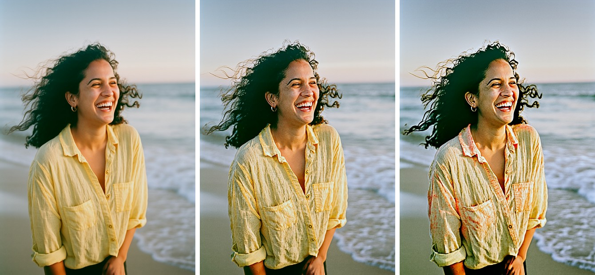

# 🖼️ P-JiT 21K for Forge Neo

> **Extension for [Stable Diffusion WebUI Forge - Neo](https://github.com/Haoming02/sd-webui-forge-classic/tree/neo)**

Generate with **[P-JiT 21K](https://www.linum.ai/field-notes/pjit-21k)** by Linum inside Forge Neo, using the checkpoint, preset and Generate button you already know. P-JiT is a small text-to-image model that draws directly in pixels, with no VAE: about 30 seconds per 1 MP picture on an 8 GB GPU.

> [!Important]
> This extension requires an up-to-date **Forge Neo** (the `neo` branch). On an older version it stays disabled and tells you so in the console - Forge Neo itself keeps working as usual.

> [!Warning]
> P-JiT 21K is an experimental research model, and it **cannot write text**: it was trained without rendered text, so signs, logos and posters will not work. It also struggles with full-body shots, crowds, several people interacting, and details such as the dots on a die.

---

## 📋 Table of Contents

- [What's New](#-whats-new)
- [Features](#-features)
- [Installation](#-installation)
- [Recommended Settings](#%EF%B8%8F-recommended-settings)
- [Writing Captions](#%EF%B8%8F-writing-captions)
- [Tips](#-tips)
- [Credits](#-credits)

---

## 🆕 What's New

### v0.1.0 - First Release

- **P-JiT 21K in Forge Neo** - text-to-image and image-to-image, with the BF16 and INT8 files.
- **No VAE to pick** - the model works in pixels, so only the text encoder goes under **VAE / Text Encoder**.
- **Linum's sampling** - adaptive projected guidance on the CFG Scale slider, and a **P-JiT** schedule.
- **pjit UI preset** - ready to generate.

---

## 🎯 Features

### 🖼️ Native Generation

- Runs inside txt2img and img2img - no separate tab, no extra environment
- Works with the Forge Neo model folders and the **VAE / Text Encoder** selector you already use
- About 30 seconds at 1024x1024 with the INT8 files on an 8 GB GPU, at 50 steps with CFG
- Hires fix, batches and the live preview work as usual, and the preview shows the real picture as it forms

### 🏰 Elaborate Scenes

- A caption can hold a whole scene: a person at work, a room full of objects, a sleeping cat and the light through the window
- Objects and places come out well; exactly what sits on what is less reliable, so try a few seeds

### 🎨 Image-to-Image

- Works best as a refiner: **Denoising strength** from 0.15 to 0.45 sharpens the fine detail and keeps the picture
- At 0.6 and above the textures turn harsh, whatever the CFG (the last picture above)

### 🛡️ Safe by Design

- Changes no Forge Neo file - remove the extension and everything is as it was
- Checks your Forge Neo at startup and stays disabled if something it needs is missing
- Tells you when the text encoder is missing or the wrong size instead of failing with a generic error
- Other models are not affected

---

## 📦 Installation

1. Open Forge Neo WebUI
2. Go to **Extensions** → **Install from URL**
3. Paste: `https://github.com/eduardoabreu81/pjit-21k-forge-neo`
4. Click **Install** and restart the WebUI
5. Download the files and place them in the usual folders:

| Part | File | Folder |
| :--- | :--- | :--- |
| P-JiT checkpoint | [`pjit_21k_int8_convrot`](https://huggingface.co/PedroMarinhoDev/P-JiT-21K-ComfyUI/blob/main/diffusion_models/pjit_21k_int8_convrot.safetensors) (2.3 GB) or [`pjit_21k_bf16`](https://huggingface.co/PedroMarinhoDev/P-JiT-21K-ComfyUI/blob/main/diffusion_models/pjit_21k_bf16.safetensors) (4.4 GB) | `models/Stable-diffusion` |
| Qwen3.5 **4B** text encoder | [`qwen3.5_4b_int8_convrot`](https://huggingface.co/PedroMarinhoDev/P-JiT-21K-ComfyUI/blob/main/text_encoders/qwen3.5_4b_int8_convrot.safetensors) (4.7 GB) or [`qwen3.5_4b_bf16`](https://huggingface.co/Comfy-Org/Qwen3.5/blob/main/text_encoders/qwen3.5_4b_bf16.safetensors) (9.3 GB) | `models/text_encoder` |

The Qwen3.5 **9B** of MOSS-Image will not work: the model was trained on the 4B. New text encoder files appear in the list after a restart of Forge Neo.

6. Pick the **pjit** UI preset and the checkpoint, and the text encoder under **VAE / Text Encoder**. There is no VAE to select

So far only the INT8 files have been run on a GPU; the BF16 ones are checked against the model's structure, not yet generated with.

---

## ⚙️ Recommended Settings

| Sampler | Schedule type | Steps | CFG |
| :--- | :--- | :--- | :--- |
| Euler | P-JiT | 50 | 15 |

The **pjit** preset sets these values. Leave the **negative prompt** empty.

The model was trained at five sizes, about 1 MP each; others run, but it has not seen them:

| Width x height | Shape |
| :--- | :--- |
| 1024 x 1024 | Square |
| 864 x 1216 | Tall |
| 1152 x 864 | 4:3 |
| 1248 x 832 | 3:2 |
| 1280 x 720 | 16:9 |

---

## ✍️ Writing Captions

The model was trained on dense captions of **50 to 80 words**, and short prompts give noticeably worse pictures. Write a few plain sentences, not a list of keywords:

- Say what is there, the colours, what a person wears and does, the framing, the light and the background
- Name a look when you want one: 35mm film, on-camera flash, soft colored pencil
- Write numbers as words, and leave out anything written in the picture

> A Brazilian woman in her late twenties laughs on a beach at golden hour in a waist-up portrait shot on 35mm film with visible grain, her dark curly hair blown across one cheek by the sea wind. She wears a faded yellow linen shirt with the sleeves rolled up and small gold hoop earrings. Warm low sun lights the side of her face, and the pale surf behind her falls into a soft blur.

Linum's own tool rewrites short prompts through a paid online service. This extension does not connect to anything: ask any assistant to expand your idea into a caption like the one above and paste it in.

---

## 💡 Tips

- Captions are cut at 256 tokens - the counter by the prompt box shows how close you are
- Lower CFG gives softer pictures; 15 is what the model was tuned on
- Sides that are not a multiple of 32 work, but stick to the sizes above for the best results
- Seeds will not reproduce the sample images on Linum's page: their code draws its noise as a specific data-center GPU does, and Forge Neo draws its own
- Before uninstalling, switch the UI preset to another one

---

## 📄 Credits

- **[Forge Neo](https://github.com/Haoming02/sd-webui-forge-classic/tree/neo)** by Haoming02
- **[P-JiT 21K](https://huggingface.co/Linum-AI/pjit-21k)** by [Linum](https://www.linum.ai) - the model and its [reference code](https://github.com/Linum-AI/pjit-21k)
- **[P-JiT 21K for ComfyUI](https://huggingface.co/PedroMarinhoDev/P-JiT-21K-ComfyUI)** by PedroMarinhoDev - the BF16 and INT8 files
- **[Qwen3.5](https://huggingface.co/Qwen/Qwen3.5-4B)** by the Qwen team - the text encoder

The weights are released under the Apache License 2.0; this extension does not include them.

---

## 📜 License

AGPL-3.0 - see [LICENSE](LICENSE)

---

Made with ❤️ for the Stable Diffusion community

**[Report Bug](https://github.com/eduardoabreu81/pjit-21k-forge-neo/issues)** • **[Request Feature](https://github.com/eduardoabreu81/pjit-21k-forge-neo/issues)** • **[☕ Ko-fi](https://ko-fi.com/eduardoabreu81)**

